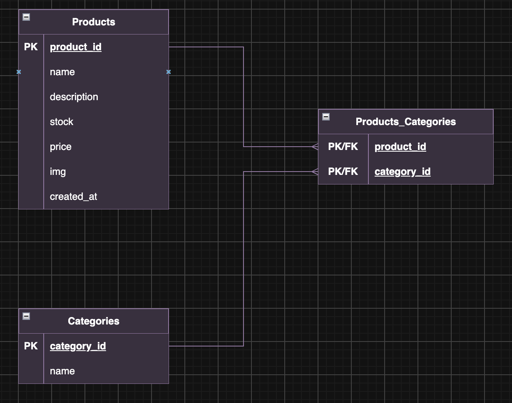

# API Development Project

An assignment focused on API development and database normalization, demonstrating the design of a relational database and an API for interacting with it.

## Database Documentation

The database documentation is located in the folder `src/misc/`.

- **ER Diagram:** `src/misc/ER-diagram.png`
- **Products table:** `src/misc/products.sql`
- **Categories table:** `src/misc/categories.sql`
- **Products-Categories relationship:** `src/misc/products_categories.sql`

The SQL files contain the table structures, relationships, and data used by the app.

### ER diagram



## API Endpoints

### Products

The API has the following endpoints for handling products:

| Method | Endpoint        | Description                |
| ------ | --------------- | -------------------------- |
| GET    | `/products`     | Get all products           |
| GET    | `/products/:id` | Get a specific product     |
| POST   | `/products`     | Create a new product       |
| PATCH  | `/products/:id` | Update an existing product |
| DELETE | `/products/:id` | Delete a product           |

---

### Product Data

Each product contains the following fields:

| Field         | Description                                  | Required                |
| ------------- | -------------------------------------------- | ----------------------- |
| `product_id`  | Unique product ID, automatically incremented | Automatically generated |
| `name`        | Product name                                 | Yes                     |
| `description` | Product description                          | Yes                     |
| `price`       | Product price                                | Yes                     |
| `stock`       | Available stock quantity                     | Yes                     |
| `img`         | Product image URL/path                       | No                      |
| `created_at`  | Timestamp when the product was created       | Automatically generated |

---

When creating a product with `POST /products`, the following fields are required:

- `name`
- `description`
- `price`
- `stock`

The `product_id` and `created_at` fields are generated automatically and should not be provided when creating a product.

When updating a product with `PATCH /products/:id`, one or more fields can be updated at a time. The `product_id` and `created_at` fields cannot be updated.

### Product Sorting

The `GET /products` endpoint supports sorting by name or price.

Use the following query parameters:

- `sort`: `name`, or `price`
- `order`: `asc` or `desc`

**Examples:**

```text
GET /products?sort=name&order=asc
GET /products?sort=name&order=desc
GET /products?sort=price&order=asc
GET /products?sort=price&order=desc
```

If no sorting parameters are provided, products are sorted by product_id in ascending order.

---

### Categories

The API has the following endpoints for handling categories:

| Method | Endpoint                   | Description                               |
| ------ | -------------------------- | ----------------------------------------- |
| GET    | `/categories`              | Get all categories                        |
| GET    | `/categories/:id/products` | Get all products from a specific category |
| POST   | `/categories`              | Create a new category                     |
| PATCH  | `/categories/:id`          | Update an existing category               |
| DELETE | `/categories/:id`          | Delete a category                         |

---

### Category Data

Each category contains the following fields:

| Field         | Description                                   | Required       |
| ------------- | --------------------------------------------- | -------------- |
| `category_id` | Unique category ID, automatically incremented | Auto-generated |
| `name`        | Category name                                 | Yes            |
